# ⚡ Awesome Low-Code Custom App Development 🚀

> 🌟 A definitive, SEO-optimized directory of top **Low-Code Custom App Development Platforms (LCAP)**, internal tool builders, visual CRUD generators, and enterprise workflow engines — comparing market-leading **SaaS solutions** and self-hosted **open-source software**. 🌟

  
  
  
  
  
  
  

---

## 📑 Table of Contents

- [🌐 Sector Overview & Market Dynamics](#-sector-overview--market-dynamics)
- [🟦 SaaS / Hosted Commercial Platforms](#-saas--hosted-commercial-platforms)
  - [SaaS Platforms Comparison Table](#-saas-platforms-comparison-table)
  - [Detailed SaaS Profiles](#-detailed-saas-profiles)
- [🟩 Open-Source Software (Ranked by Stars)](#-open-source-software-ranked-by-stars)
  - [1. Supabase](#1-supabase-)
  - [2. Strapi](#2-strapi-)
  - [3. NocoDB](#3-nocodb-)
  - [4. PocketBase](#4-pocketbase-)
  - [5. Appsmith](#5-appsmith-)
  - [6. ToolJet](#6-tooljet-)
  - [7. Directus](#7-directus-)
  - [8. Refine](#8-refine-)
  - [9. Budibase](#9-budibase-)
  - [10. NocoBase](#10-nocobase-)
  - [11. Windmill](#11-windmill-)
  - [12. Amplication](#12-amplication-)
  - [13. ILLA Cloud](#13-illa-cloud-)
  - [14. Baserow](#14-baserow-)
  - [15. Openblocks](#15-openblocks-)
  - [16. Saltcorn](#16-saltcorn-)
  - [17. Lowcoder](#17-lowcoder-)
- [📊 Feature Matrix & Architecture Breakdown](#-feature-matrix--architecture-breakdown)
- [📈 Star History](#-star-history)
- [🤝 Contributing](#-contributing)
- [💖 Support & Sponsoring](#-support--sponsoring)
- [📄 License](#-license)

---

## 🌐 Sector Overview & Market Dynamics

The global **Low-Code Custom Application Development Platform (LCAP)** market was estimated at **$28.5 Billion in 2024** and is projected to expand at a compound annual growth rate (**CAGR of 24.8%**) to surpass **$150 Billion by 2032**, driven by the relentless enterprise demand for accelerated software delivery and citizen developer enablement.

The sector exhibits a **moderately fragmented and bifurcated market structure**: mega-cap tech conglomerates and established low-code giants (Microsoft, Siemens/Mendix, Appian, OutSystems) command enterprise tier mission-critical systems and ERP integrations, while an intensely competitive, fast-growing tier of agile SaaS builders (Retool, Quickbase, Zoho Creator) and self-hosted open-source disruptors (Supabase, Appsmith, ToolJet, Budibase, Refine) capture developer-centric internal tooling, administrative dashboards, and data-sovereign custom applications.

---

## 🟦 SaaS / Hosted Commercial Platforms

### 📊 SaaS Platforms Comparison Table

*Sorted in descending order by **Company Size (Revenue / Market Cap / Valuation)**.*

| 🏢 Platform / Tool | 💰 Company Size (Valuation / Revenue) | 🏷️ Starting Tier Pricing | 🎁 Free Tier Limit / Free Trial Limit | 🎯 Key Strengths & Target Use Case |
|---|---|---|---|---|
| **[Microsoft Power Apps](https://powerapps.microsoft.com/)** | **~$3.1T** Market Cap / **$245B** Rev *(Microsoft)* | **$20/user/month** (Premium) or **$10/user/app/mo** (Pay-As-You-Go) | **Free Developer Plan ($0 forever)**: 3 non-production dev environments, 2 GB Dataverse database capacity, 750 Power Automate flow runs/month. | Native integration with Microsoft 365, Azure, Dynamics 365, Dataverse, and enterprise Power Platform governance. |
| **[Mendix](https://www.mendix.com/)** | **~$160B** Market Cap / **$82B** Rev *(Siemens AG)* | **$1,090/month** (Standard 1-App tier, billed annually) | **Free Forever Sandbox Tier ($0)**: Unlimited Studio Pro IDE access; test deployment in Mendix Cloud; apps sleep after 1 hour of inactivity. | High-scale enterprise low-code modeling, multi-cloud container deployments, and deep SAP / Siemens industrial ecosystem ties. |
| **[Zoho Creator](https://www.zoho.com/creator/)** | **~$13B** Valuation / **$1.4B+** ARR *(Zoho Corp)* | **$8/user/month** (Standard tier, 1 app) or **$20/user/month** (Professional) | **Free Forever Plan ($0)**: 1 app, up to 1 user, 5,000 records, 250 MB storage + **15-Day Free Trial** of paid features without credit card. | Rapid business workflow applications powered by Deluge scripting, built-in forms, BI dashboards, and seamless Zoho app integrations. |
| **[Retool](https://retool.com/)** | **$3.2B** Valuation (Series C) / **~$100M+** ARR | **$10/builder/month** + **$5/user/month** (Team, billed annually) | **Free Forever Plan ($0)**: Up to 5 total users, unlimited web/mobile apps, 500 workflow runs/month, 5 GB Retool DB, 250 AI credits/mo. | The industry standard internal tool and admin panel builder for developers with visual drag-and-drop React UI, direct DB/API connections, and custom JS. |
| **[OutSystems](https://www.outsystems.com/)** | **$3.0B** Valuation / **~$300M+** ARR | **~$36,300/year** (Entry commercial baseline, quote-based) | **Free Personal Edition ($0 forever)**: 1 cloud dev environment, up to 100 internal test users, 1 GB database storage (sleeps on inactivity). | Enterprise-grade full-stack visual development, automated CI/CD lifecycle management, strict security governance, and multi-tier architectures. |
| **[Appian](https://appian.com/)** | **~$2.5B** Market Cap *(NASDAQ: APPN)* / **$550M** Rev | **~$75/user/month** (Standard entry tier estimate; custom quote) | **Appian Community Edition ($0 forever developer tier)**: 1 environment, up to 15 users, 25,000 rows/synced record, 1 RPA bot (50 runs/day). | End-to-end business process orchestration, case management, regulatory audit trails, and process mining for heavily regulated sectors. |
| **[Quickbase](https://www.quickbase.com/)** | **~$1.2B** Valuation *(Vista Equity)* / **~$200M+** ARR | **$35/user/month** (Team plan, billed annually; min seat count) | **30-Day Free Trial ($0)**: Full platform access to Business Plan features, up to 50 active apps, and complete pipeline automations. | Replacing legacy spreadsheets and disconnected operational databases with structured departmental workflow apps. |
| **[Caspio](https://www.caspio.com/)** | **~$300M** Valuation / **~$50M** ARR | **$300/month** (Team tier, billed annually; includes unlimited users) | **14-Day Free Trial ($0)**: Complete access to Team plan features, unlimited app users, relational cloud database, and interactive DataPages. | Database-first cloud application builder featuring zero per-seat user fees, strict compliance certifications (HIPAA/FERPA/SOC2), and embedded forms. |
| **[Betty Blocks](https://www.bettyblocks.com/)** | **~$180M** Valuation / **~$25M** ARR | **€1,500/month** (~$1,750/mo, Create plan; unlimited users) | **14-Day Free Evaluation Sandbox ($0)**: Full access to visual drag-and-drop UI builder, data modeling blocks, and AI-assisted generation. | Governed citizen development platform enabling non-technical business teams to build secure enterprise apps under IT supervision. |
| **[Glide](https://www.glideapps.com/)** | **~$150M** Valuation *(Benchmark)* / **~$15M** ARR | **$19/month** (Explorer tier) or **$99/month** (Team tier) | **Free Forever Plan ($0)**: Up to 3 apps, 500 records per app, 1,000 updates/month, private preview testing, and personal sandbox builder. | Instant no-code mobile and web app creation directly on top of Google Sheets, Excel, Airtable, and SQL data sources. |

---

### 🔍 Detailed SaaS Profiles

#### 🔹 [Microsoft Power Apps](https://powerapps.microsoft.com/)
* **Category:** Enterprise Low-Code Application Platform (LCAP)
* **Overview:** Power Apps empowers organizations to build custom desktop and mobile applications connected to data stored either in the underlying data platform (Microsoft Dataverse) or across hundreds of cloud and on-premises data sources (SharePoint, SQL Server, Microsoft 365, Salesforce). Features formula-driven logic using Power Fx and automated workflows via Power Automate.

#### 🔹 [Mendix](https://www.mendix.com/)
* **Category:** Enterprise Model-Driven App Platform
* **Overview:** Mendix by Siemens is an enterprise-grade platform offering visual model-driven development for both business domain experts and professional developers. It supports continuous delivery, native mobile compilation, automated testing, and multi-cloud container orchestration on AWS, Azure, and private Kubernetes clusters.

#### 🔹 [Zoho Creator](https://www.zoho.com/creator/)
* **Category:** All-in-One Cloud Application Builder
* **Overview:** Zoho Creator provides a low-code environment to build custom business software with drag-and-drop form builders, relational schemas, and workflow automation driven by Deluge scripting. It includes built-in AI capabilities, customer portal generation, and native integration into Zoho's 50+ business apps.

#### 🔹 [Retool](https://retool.com/)
* **Category:** Developer-First Internal Tool Platform
* **Overview:** Retool enables engineering teams to rapidly assemble internal dashboards, admin consoles, and CRUD tools. Instead of assembling React components and CSS boilerplate from scratch, developers drag and drop 100+ robust UI widgets and connect them directly to PostgreSQL, MySQL, REST APIs, GraphQL, and cloud providers with custom JavaScript logic.

#### 🔹 [OutSystems](https://www.outsystems.com/)
* **Category:** High-Performance Enterprise Low-Code
* **Overview:** OutSystems addresses complex core application modernization with visual full-stack modeling, automated single-click deployment, and architectural governance. It delivers native performance and enterprise-grade scalability for customer-facing web/mobile applications and legacy ERP extensions.

#### 🔹 [Appian](https://appian.com/)
* **Category:** Process Automation & Case Management Platform
* **Overview:** Appian unites low-code rapid app building with advanced Business Process Management (BPM), Robotic Process Automation (RPA), data fabric architecture, and AI copilots. It is trusted in defense, banking, healthcare, and public sector organizations requiring end-to-end process visibility and compliance audits.

#### 🔹 [Quickbase](https://www.quickbase.com/)
* **Category:** Dynamic Operational Database & Workflow Builder
* **Overview:** Quickbase enables operational leaders and IT teams to centralize complex projects, supply chain tracking, and field asset operations. Its no-code relational database engine allows rapid schema iterations, granular role permissions, and pipeline triggers without dedicated database administrators.

#### 🔹 [Caspio](https://www.caspio.com/)
* **Category:** No-Code Relational Database Application Platform
* **Overview:** Caspio is built on a scalable cloud database architecture that charges per resource rather than per seat. It enables organizations to embed interactive searchable databases, client portals, and multi-step forms seamlessly into any public or private website.

#### 🔹 [Betty Blocks](https://www.bettyblocks.com/)
* **Category:** Governed Citizen Development Platform
* **Overview:** Betty Blocks provides a 100% cloud-based environment where business analysts and developers collaborate. It enforces strict separation of concerns: citizen developers build UI and workflows with visual blocks, while professional developers supply custom integrations and microservices.

#### 🔹 [Glide](https://www.glideapps.com/)
* **Category:** Data-to-App Rapid No-Code Platform
* **Overview:** Glide transforms structured spreadsheets and databases into modern, responsive web and mobile applications in minutes. With adaptive layouts, built-in action sequences, and AI workflows, it excels at inventory trackers, employee directories, and customer portals.

---

## 🟩 Open-Source Software (Ranked by Stars)

*All open-source repositories below are sorted in descending order by **GitHub_Stars_Count**. Every badge links directly to that project's stargazers page.*

---

### 1. [Supabase](https://github.com/supabase/supabase) 
* **Tech Stack:** TypeScript / Elixir / Go / PostgreSQL | **License:** Apache-2.0
* **Overview:** Known as the open-source Firebase alternative, Supabase provides an instant low-code backend suite for building custom web and mobile applications. It automatically generates RESTful and GraphQL APIs from your PostgreSQL schema, with built-in authentication, row-level security (RLS), real-time WebSockets, vector embeddings, and an interactive database Studio UI.
* **Best For:** Developers wanting a production-ready PostgreSQL backend with auto-generated APIs, authentication, and visual database management.

---

### 2. [Strapi](https://github.com/strapi/strapi) 
* **Tech Stack:** JavaScript / TypeScript / Node.js / React | **License:** MIT
* **Overview:** Strapi is the leading open-source headless CMS and custom API builder. It offers a visual content modeling studio, customizable admin dashboard, role-based access control, and instant REST and GraphQL APIs. Highly extensible through custom plugins and middlewares.
* **Best For:** Teams building content-heavy applications, multi-channel customer portals, and flexible content-driven internal tools.

---

### 3. [NocoDB](https://github.com/nocodb/nocodb) 
* **Tech Stack:** Vue.js / Node.js / TypeScript | **License:** AGPL-3.0
* **Overview:** NocoDB transforms any existing relational database (PostgreSQL, MySQL, SQLite, SQL Server) into an interactive smart spreadsheet and collaborative app builder. It offers Grid, Gallery, Kanban, and Form views, automated webhooks, team collaboration features, and REST APIs.
* **Best For:** Teams seeking an open-source Airtable alternative that connects directly to their existing production SQL databases without schema lock-in.

---

### 4. [PocketBase](https://github.com/pocketbase/pocketbase) 
* **Tech Stack:** Go / SQLite / Svelte | **License:** MIT
* **Overview:** PocketBase is an all-in-one open-source backend contained in a single lightweight Go executable. It features embedded SQLite with real-time subscriptions, client-side authentication, file storage, and an elegant admin dashboard for managing collections and security rules.
* **Best For:** Solo developers and small teams looking to deploy custom web and mobile apps on minimal VPS infrastructure with zero DevOps overhead.

---

### 5. [Appsmith](https://github.com/appsmithorg/appsmith) 
* **Tech Stack:** Java / React / TypeScript / MongoDB | **License:** Apache-2.0
* **Overview:** Appsmith is an open-source framework for building internal tools, admin panels, and operational dashboards. It provides 45+ customizable drag-and-drop UI widgets, pre-built connectors to databases and REST/GraphQL APIs, and native JavaScript binding across the entire UI canvas. Its permissive Apache-2.0 license allows white-labeling and embedding into custom products.
* **Best For:** Teams prioritizing a permissive open-source license, high release cadence, and embedded internal applications.

---

### 6. [ToolJet](https://github.com/ToolJet/ToolJet) 
* **Tech Stack:** Node.js / React / TypeScript / PostgreSQL | **License:** AGPL-3.0
* **Overview:** ToolJet is a feature-rich low-code framework for building and deploying internal business tools. It features a canvas with 45+ pre-built UI components, 50+ native database and cloud connectors, multi-user real-time collaboration, role-based access control (RBAC), and built-in AI workflow agents.
* **Best For:** Organizations seeking a comprehensive, self-hosted Retool alternative with granular permission controls and active community plugins.

---

### 7. [Directus](https://github.com/directus/directus) 
* **Tech Stack:** TypeScript / Node.js / Vue.js | **License:** BSL 1.1 / Apache-2.0
* **Overview:** Directus is a data engine that layers dynamic REST/GraphQL APIs and an intuitive no-code data management studio on top of any SQL database. It does not alter your existing schema or force proprietary migrations, providing instant CRUD management, granular RBAC, and workflow automation.
* **Best For:** Complex enterprise database backends requiring real-time APIs, customizable admin panels, and non-destructive schema access.

---

### 8. [Refine](https://github.com/refinedev/refine) 
* **Tech Stack:** TypeScript / React / Next.js / Ant Design / Material UI | **License:** MIT
* **Overview:** Refine is an open-source, code-first meta-framework for developing enterprise internal tools, admin panels, B2B portals, and dashboards. Rather than locking developers into a visual canvas, it decouples the business logic, state management, routing, and data providers from the UI components.
* **Best For:** Software engineers who want full programmatic control, code reviews, and enterprise UI component libraries without low-code ceiling limitations.

---

### 9. [Budibase](https://github.com/Budibase/budibase) 
* **Tech Stack:** Node.js / Svelte / CouchDB | **License:** GPL-3.0 (Community) / Proprietary
* **Overview:** Budibase is an all-in-one low-code platform for building, designing, and automating business apps and forms. It includes its own built-in internal table database, connectors to external SQL/NoSQL backends, a visual screen designer with responsive components, and automated multi-step cron workflows.
* **Best For:** Teams wanting an accessible self-hosted builder with an integrated database and straightforward visual workflow automations.

---

### 10. [NocoBase](https://github.com/nocobase/nocobase) 
* **Tech Stack:** TypeScript / Node.js / React / PostgreSQL | **License:** AGPL-3.0
* **Overview:** NocoBase is a private-first, highly extensible open-source no-code development platform. Its architecture completely decouples data models from user interfaces, allowing users to build complex domain-driven ERP, CRM, and management systems using micro-kernel plugins and configurable blocks.
* **Best For:** Enterprises and dev agencies building complex internal systems with intricate relational data models and custom plugin requirements.

---

### 11. [Windmill](https://github.com/windmill-labs/windmill) 
* **Tech Stack:** Rust / Go / TypeScript / PostgreSQL | **License:** AGPL-3.0
* **Overview:** Windmill is a developer platform that turns scripts (written in Python, TypeScript, Go, or Bash) into production webhooks, background workflows, and auto-generated user interfaces. Benchmarked as up to 13x faster than Airflow, it combines code-first script execution with a drag-and-drop UI canvas.
* **Best For:** Technical engineering and DevOps teams wanting to convert existing script libraries into shared internal tools and distributed workflows.

---

### 12. [Amplication](https://github.com/amplication/amplication) 
* **Tech Stack:** TypeScript / Node.js / NestJS / Prisma | **License:** Apache-2.0
* **Overview:** Amplication is an open-source development tool that automatically generates production-ready backend services and REST/GraphQL APIs based on TypeScript and NestJS. It provisions data models, Prisma ORM integrations, authentication, and role permissions, pushing human-readable code directly to your GitHub repository.
* **Best For:** Backend developers building modern microservices and custom application architectures who want to eliminate CRUD boilerplate.

---

### 13. [ILLA Cloud](https://github.com/illacloud/illa-builder) 
* **Tech Stack:** Go / TypeScript / React | **License:** Apache-2.0
* **Overview:** ILLA Cloud is an open-source low-code platform for creating internal tools and integrating generative AI agents into business operations. It provides a visual canvas with dozens of pre-designed widgets, real-time multi-developer collaboration, and native connectors to LLMs (OpenAI, Hugging Face) and databases.
* **Best For:** Teams looking to rapidly build internal interfaces with native AI integration and collaborative real-time editing.

---

### 14. [Baserow](https://github.com/baserow/baserow) 
* **Tech Stack:** Python / Django / Vue.js / PostgreSQL | **License:** MIT (Community)
* **Overview:** Baserow is an open-source no-code database and application builder. It combines an Airtable-like relational table interface with a dedicated Application Builder that lets non-technical users build public and private customer portals, interactive directories, and forms without code.
* **Best For:** Organizations seeking a self-hostable, MIT-licensed Airtable alternative with an integrated frontend application designer.

---

### 15. [Openblocks](https://github.com/openblocks-dev/openblocks) 
* **Tech Stack:** TypeScript / React / Node.js | **License:** AGPL-3.0
* **Overview:** Openblocks is an open-source low-code internal tool platform that combines visual page composition with JavaScript programmability. It includes an extensive component library, query builders for databases and REST APIs, and granular user permission control.
* **Best For:** Engineering teams looking for a lightweight, modular self-hosted alternative to Retool and ToolJet.

---

### 16. [Saltcorn](https://github.com/saltcorn/saltcorn) 
* **Tech Stack:** Node.js / PostgreSQL / SQLite | **License:** MIT
* **Overview:** Saltcorn is an extensible open-source no-code application builder engineered for simplicity and minimal server resource usage. Capable of running smoothly on a low-end 2 GB VPS, it features point-and-click relational database design, customizable views, and an ecosystem of community plugins.
* **Best For:** Small businesses, indie hackers, and non-profits needing a lightweight, self-hosted web app builder with an unencumbered MIT license.

---

### 17. [Lowcoder](https://github.com/lowcoder-org/lowcoder) 
* **Tech Stack:** TypeScript / React / Java / Node.js | **License:** AGPL-3.0
* **Overview:** Lowcoder is an open-source low-code platform focused on building internal applications, admin panels, and customer-facing workflows. It provides a visual canvas, reusable custom components, JavaScript query evaluations, and role-based workspace permissions.
* **Best For:** Teams wanting a self-hosted Retool alternative with custom UI module support and simple Docker container deployment.

---

## 📊 Feature Matrix & Architecture Breakdown

| 🛠️ Platform | 📜 License / Type | 💻 Tech Stack | 🗄️ Built-in DB | 🎨 UI Builder Type | 🏠 Self-Hostable | 🏆 Best Use Case |
|---|---|---|---|---|---|---|
| **Microsoft Power Apps** | Proprietary SaaS | Cloud Native | Dataverse | Drag-and-drop Visual | ❌ Cloud Only | Microsoft 365 / Azure enterprise ecosystem |
| **Mendix** | Commercial SaaS | Model-Driven | Cloud DB | Visual Model-driven | ❌ Cloud / Hybrid | Enterprise multi-cloud apps with high governance |
| **Zoho Creator** | Commercial SaaS | Deluge Scripting | Cloud DB | Drag-and-drop Visual | ❌ Cloud Only | Rapid custom business apps & Zoho ecosystem |
| **Retool** | Commercial SaaS | React / JS / Cloud | Retool DB | Component Canvas | ⚠️ Enterprise only | Fast developer-built internal tools & dashboards |
| **OutSystems** | Commercial SaaS | Full-Stack Low-Code | Cloud DB | Visual Full-Stack | ❌ Cloud / Dedicated | Mission-critical enterprise core systems |
| **Appian** | Commercial SaaS | Java / BPM Engine | Data Fabric | Visual Process Modeler| ❌ Cloud / Hybrid | Complex case management & regulated workflows |
| **Quickbase** | Commercial SaaS | Relational Engine | Built-in | Drag-and-drop Forms | ❌ Cloud Only | Operational tracking replacing spreadsheets |
| **Caspio** | Commercial SaaS | Relational Cloud DB| Built-in | Visual DataPages | ❌ Cloud Only | Database web apps with unlimited users |
| **Betty Blocks** | Commercial SaaS | Elixir / Cloud | Built-in | Visual Block Canvas | ❌ Cloud Only | Governed citizen development for enterprises |
| **Glide** | Commercial SaaS | Web Components | Sheets / SQL | Visual Adaptive UI | ❌ Cloud Only | Instant mobile/web apps from spreadsheets |
| **Supabase** | Apache-2.0 (OSS) | TS / Elixir / Postgres| PostgreSQL | Studio DB Manager | ✅ Yes (Docker) | Production Postgres backend & instant APIs |
| **Strapi** | MIT (OSS) | Node.js / React | External DB | Headless Admin Panel| ✅ Yes (Node/Docker)| Content-driven apps & headless CMS APIs |
| **NocoDB** | AGPL-3.0 (OSS) | Node.js / Vue | External DB | Smart Spreadsheet | ✅ Yes (Docker) | Airtable-like smart spreadsheet for SQL databases |
| **PocketBase** | MIT (OSS) | Go / SQLite / Svelte | SQLite | Admin UI | ✅ Yes (Single binary)| Lightweight embedded backend on minimal VPS |
| **Appsmith** | Apache-2.0 (OSS) | Java / React / Mongo | Connectors | Drag-and-drop Canvas | ✅ Yes (Docker/K8s) | Permissive open-source internal tools & dashboards |
| **ToolJet** | AGPL-3.0 (OSS) | Node.js / React | Connectors | 45+ UI Components | ✅ Yes (Docker/K8s) | Feature-dense Retool alternative with AI agents |
| **Directus** | BSL / Apache-2.0 | Node.js / Vue | External DB | Data Studio | ✅ Yes (Docker/Node) | Dynamic API generation & data management studio |
| **Refine** | MIT (OSS) | TypeScript / React | Any API/DB | Code-First Meta | ✅ Yes (Self-hosted)| Full-code React framework for internal tools |
| **Budibase** | GPL-3.0 / Open Core| Node.js / Svelte | Built-in | Visual App Designer | ✅ Yes (Docker/K8s) | All-in-one low-code builder with automation |
| **NocoBase** | AGPL-3.0 (OSS) | Node.js / React | Any SQL DB | Block-based Pages | ✅ Yes (Docker/Node) | Complex data-model-driven internal systems |
| **Windmill** | AGPL-3.0 (OSS) | Rust / Go / TS | PostgreSQL | Script-to-UI Canvas | ✅ Yes (Docker/K8s) | Code-first script orchestration & rapid UIs |
| **Amplication** | Apache-2.0 (OSS) | NestJS / Prisma | Connectors | Backend Code Gen | ✅ Yes (Docker/Node) | Automated production-ready Node/NestJS backend |
| **ILLA Cloud** | Apache-2.0 (OSS) | Go / React / TS | Connectors | Collaborative Canvas | ✅ Yes (Docker/K8s) | Internal tools with native AI prompt integration |
| **Baserow** | MIT (OSS) | Python / Vue / Django | PostgreSQL | Spreadsheet + App | ✅ Yes (Docker) | Open-source Airtable alternative with App Builder |
| **Openblocks** | AGPL-3.0 (OSS) | Node.js / React | Connectors | Visual Canvas | ✅ Yes (Docker) | Modular internal developer tool builder |
| **Saltcorn** | MIT (OSS) | Node.js / PostgreSQL | PostgreSQL | Visual Page Builder | ✅ Yes (Docker/npx) | Lightweight no-code builder running on 2 GB VPS |
| **Lowcoder** | AGPL-3.0 (OSS) | Java / React / Node | Connectors | Drag-and-drop Canvas | ✅ Yes (Docker) | Extensible open-source Retool alternative |

---

## 📈 Star History

---

## 🤝 Contributing

Contributions are warmly welcome! If you know of an outstanding open-source Low-Code Custom App Development platform, internal tool framework, or commercial SaaS that should be listed here:

1. 🍴 **Fork** this repository.
2. 🌿 Create a new feature branch (`git checkout -b feature/add-new-tool`).
3. 📝 Add your tool with a short description, tech stack, license, and relevant GitHub_Stars_Badge.
4. 🚀 Open a well-documented **Pull Request**.

> Please ensure any suggested project has active maintenance (commits within the last 12 months) and aligns with the low-code custom application development domain.

---

## 💖 Support & Sponsoring

If this curated directory helped you choose the right low-code development platform, discover an open-source tool, or saved your team valuable evaluation time, please consider showing your support:

* ⭐ **Star this repository** to help other developers and founders discover it!
* 🍴 **Fork and share** the repo with colleagues and low-code communities.
* 📢 Mention or link this repository in your blog posts and social media.
* ☕ **Support the maintainer** via the [GitHub Sponsor Dashboard](https://github.com/sponsors/ishandutta2007).

---

## 📄 License

To the extent possible under law, the authors have dedicated all copyright and related and neighboring rights to this repository to the public domain worldwide under the [Creative Commons CC0 1.0 Universal License](file:///C:/Users/hp/Documents/Projects/Awesome-Low-Code-Custom-App-Development/LICENSE). Individual software projects listed retain their respective licenses and trademarks.
